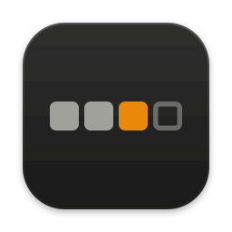
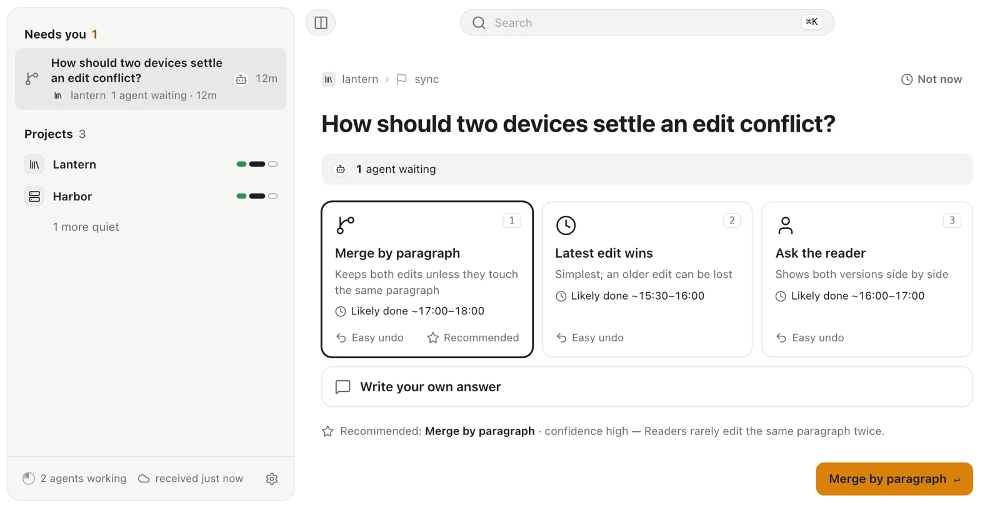
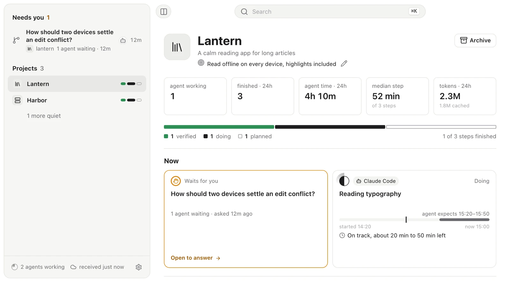
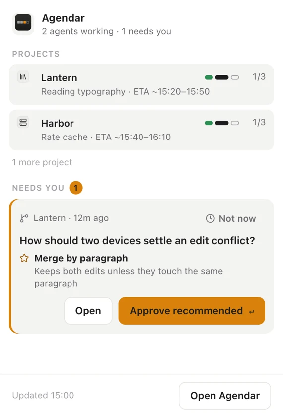

<p align="center">
  
</p>

<h1 align="center">Agendar</h1>

<p align="center">
  <b>Manage your coding agents like a product manager.</b><br>
  An agenda for your AI coding agents. It lists only what needs you. Your answer wakes the agent session that asked.
</p>

<p align="center">
  Works with Claude Code, Codex, Cursor, Gemini CLI, Antigravity, opencode, pi, and anything that runs a shell.
</p>

<p align="center">
  <a href="https://github.com/Maolon/agendar/actions/workflows/check.yml"></a>
  <a href="https://github.com/Maolon/agendar/releases/latest"></a>
  <a href="LICENSE"></a>
  
</p>

<p align="center">
  English | <a href="README.zh-CN.md">简体中文</a>
</p>

<p align="center">
  <picture>
    <source media="(prefers-color-scheme: dark)" srcset="docs/images/decision-dark.webp">
    
  </picture>
</p>

## Why

A product manager does not watch the team type. They agree on the plan, answer
the questions no one else can, review the demo, and accept it or send it back.

With coding agents, you do that job without the tools. One agent stops on a
question in a terminal tab you are not watching. The steps behind it stall.
Another says "done" and nobody checks. A third went quiet an hour ago. You find
out by reading a wall of terminals.

Agendar is the desk for that job. Run your agents wherever you like. They
report their plan and progress, ask for decisions, and deliver their work in
one place. You get one list of what needs you.

- **The plan.** Agents declare the project and its steps, with dependencies.
  You see one square per step, a plan graph, and a finish forecast adjusted by
  how long past steps took.
- **Decisions.** A question reaches you as a card with two to four options,
  what each costs, the agent's recommendation, and what your answer unblocks.
  Cards are ranked by cost of delay.
- **The answer wakes the agent.** Answer from the app, the menu bar, or a
  notification. The session that asked gets a receipt with *done when* criteria
  and continues.
- **Review.** Finished work arrives as a delivery with demos (a screenshot, a
  CLI transcript, the few diff hunks that matter) and a disclosure of what is
  proven, not proven yet, or faked for now. Accept it, or send it back with
  comments on the demo.
- **Status that corrects itself.** If a session stops or goes quiet for 24
  hours, its step is freed for another agent. The board shows what is moving,
  stalled, or untouched. You do not chase updates.
- **Budgets and policy.** Work with no demo after four hours shows as *No demo*.
  A policy (Strict, Balanced, Autopilot) sets which questions reach you and
  which the agent may assume.
- **Reports.** Proposals to read before a choice, or findings from a test or an
  audit. The summary is in the app. The full document opens in your browser.
- **Local-first.** Plain files in a folder you choose. No server, no account,
  no telemetry.

Agendar does not start agents or assign work to them. Agents declare the plan
and report on it. You decide, review, pause, and drop.

## How it works

1. **The agent reads the board and reports.** It takes a step and states when it
   expects to finish.

   ```sh
   agendar board
   agendar progress started --node core/wake --eta 30m..1h30m
   ```

2. **The agent asks.** `ask` returns at once and says whether to wait. The
   agent first does the steps that do not depend on the answer, then waits.

   ```sh
   agendar ask --question "Delete the build cache?" \
     --option "Delete: frees 49 GB" --option "Keep: next build is fast" --recommend 1
   agendar wait <ask-id>
   ```

3. **You answer.** The card appears under *Needs you*. Pick an option or write
   your own. `wait` returns the receipt to the agent, which applies your answer
   and runs `agendar ack <answer-id>`.

4. **The agent delivers, you review.** Accept closes the step. Send back
   reopens it and sends your comments to the same session.

   ```sh
   agendar deliver --node core/wake --attempt <attempt-id> --json delivery.json
   agendar wait --delivery <delivery-id>
   agendar settle
   ```

Agents learn these commands from the [Agent Skill](skills/agendar/SKILL.md).
You do not type them.

## What you see

<table>
  <tr>
    <td width="68%">
      <picture>
        <source media="(prefers-color-scheme: dark)" srcset="docs/images/project-dark.webp">
        
      </picture>
    </td>
    <td width="32%">
      <picture>
        <source media="(prefers-color-scheme: dark)" srcset="docs/images/tray-dark.webp">
        
      </picture>
    </td>
  </tr>
</table>

- **Needs you.** Questions to answer, deliveries to review, assumed answers to
  confirm, and contested steps. *Not now* snoozes an item for an hour, a day, or
  a week, on every computer that shares the Vault.
- **A project page.** Progress by step, what each agent is doing and when it
  expects to finish, reports, activity, and the plan graph.
- **The menu bar.** The top question with *Approve recommended*. Choices that
  are hard to undo require confirmation in the main window.
- **Search** across projects, steps, decisions, reports, and deliveries.
- **English, 简体中文, and 繁體中文**, light and dark.

## Works with

| Agent | How it connects |
|---|---|
| Claude Code | Hooks. A background hook wakes the idle session with your answer or verdict |
| Codex | Hooks. The thread gets your answer at its next turn |
| Cursor, Gemini CLI, Antigravity, opencode, pi | MCP server (`agendar mcp`), with `ask` and `wait` as tools |
| Anything that runs a shell | The `agendar` CLI and the Agent Skill |

Agent environments like Paseo and Conductor, or the Claude and Codex desktop
apps, are where these agents run. Agendar works beside any of them.

## Install

**1. Download the app** from the
[latest release](https://github.com/Maolon/agendar/releases/latest). The CLI is
bundled inside. There is nothing else to install.

| Platform | File |
|---|---|
| macOS, Apple silicon | `Agendar_<version>_aarch64.dmg` |
| macOS, Intel | `Agendar_<version>_x64.dmg` |
| Windows | `Agendar_<version>_x64-setup.exe` |
| Linux | `.deb` or `.AppImage` |

On first launch, Setup asks where to store your agenda and offers to link
`agendar` onto your PATH. Nothing is installed until you click its button.

> **macOS:** The app is not notarized yet. On first launch, open it, then go to
> **System Settings > Privacy & Security** and choose **Open Anyway**. Or run
> `xattr -dr com.apple.quarantine /Applications/Agendar.app` once.
> **Windows:** SmartScreen may warn about an unknown publisher. Choose
> **More info > Run anyway**.

**2. Connect your agents** in **Settings > Agents**, or from the terminal an
agent runs in:

```sh
agendar bind        # detects the harness; adds hooks or the MCP server
agendar bindings    # shows how each harness on this machine is connected
```

**3. Teach agents the loop** with the Agent Skill:

```sh
npx skills add Maolon/agendar -g
```

Each release also includes the standalone `agendar` CLI (`agendar-cli-*`) for
machines that only run agents, and a `.sha256` checksum for every file.

## Principles

- **Local.** Records are plain JSON Lines files in one folder, the Vault. Put
  it in iCloud Drive, OneDrive, Dropbox, Syncthing, or keep it on one disk.
- **No server, no account.** Each machine appends to its own files. Machines
  that share a folder converge by replaying events.
- **No telemetry.** The only network request checks the GitHub releases API for
  updates. It installs nothing, and you can turn it off.
- **Consent first.** Setup installs nothing until you click its button.
  `agendar install-hooks` and `agendar install-mcp` print a plan and write only
  with `--yes`.
- **Honest status.** An agent's "done" is shown as *Agent says*. Only what the
  app observed is shown as *Seen*.
- **Open.** MIT license.

## FAQ

**How is this different from an agent environment like Paseo, Conductor, or the
Claude and Codex desktop apps?**
Those run agents. They give each one a worktree, a terminal, and a chat. They
are the workshop. Agendar does not run agents. It is the board and decision
loop beside whichever environment you use, and it covers all of them at once.
If you use one environment and one agent at a time, its built-in chat may be
all you need.

**Does Agendar start agents or assign work?**
No. Agents declare the plan and take steps themselves. You answer, review,
edit the goal, pause a step, or drop it. Agendar records that intent. It never
starts, resumes, or stops a session.

**How does my answer reach the agent?**
In Claude Code, a background hook waits for the answer and wakes the idle
session with it. Codex gets it through its hooks at the thread's next turn.
MCP agents call the `wait` tool. Any other agent runs `agendar wait <ask-id>`
or reads `agendar inbox`.

**What if I do not answer?**
A card can carry a default. When its timer expires, the agent proceeds with the
recommendation, and the answer appears as an assumption for you to confirm.
Without a default, the step holds. Other steps keep going.

**Where is my data?**
In the folder you chose at setup, as plain files, plus an index in the app's
local data folder. Nothing is sent anywhere. The app reads token counts from
local Claude Code and Codex logs to show usage. Message text is not kept.

**Can several machines share one agenda?**
Yes. Point them at the same synced folder. This is tested with simulated
hosts. Real multi-machine use is still thin.

**Which platforms?**
macOS (Apple silicon and Intel), Windows, and Linux. macOS is the platform it
is tested on. Windows and Linux build and pass the tests in CI, but have seen
little real use.

**What does it cost?**
Nothing. Agendar is free and open source.

## Build from source

Rust 1.94.1 (pinned in `rust-toolchain.toml`), Node 26, and `pnpm@10.33.2`.

```sh
pnpm -C app install --frozen-lockfile
cargo test --workspace
pnpm -C app test

# Run the app with sample data and no setup
cd app && VITE_AGENDAR_FIXTURES=1 pnpm dev

# Build the installable app (the CLI is bundled inside it)
cd app && node scripts/bundle-cli.mjs && pnpm exec tauri build --bundles app
```

The project layout:

- `crates/agendar-core`: the event model, the append-only store, the SQLite
  index, and the reducer that turns events into plans, progress, decisions, and
  forecasts.
- `crates/agendar-cli`: the `agendar` command agents run, including the MCP
  server and the harness hooks.
- `crates/agendar-notify`, `crates/agendar-chrome`, `crates/agendar-ffi`: native
  desktop notifications, macOS window chrome, and the UniFFI facade over the
  core.
- `app/`: the desktop app (Tauri 2, React, and TypeScript).
- `skills/agendar/`: the Agent Skill.

See [`CONTRIBUTING.md`](CONTRIBUTING.md) for the change and release workflow,
and [`AGENTS.md`](AGENTS.md) for the rules that apply to people and coding
agents changing the code.

## License

[MIT](LICENSE)
