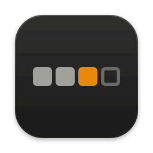
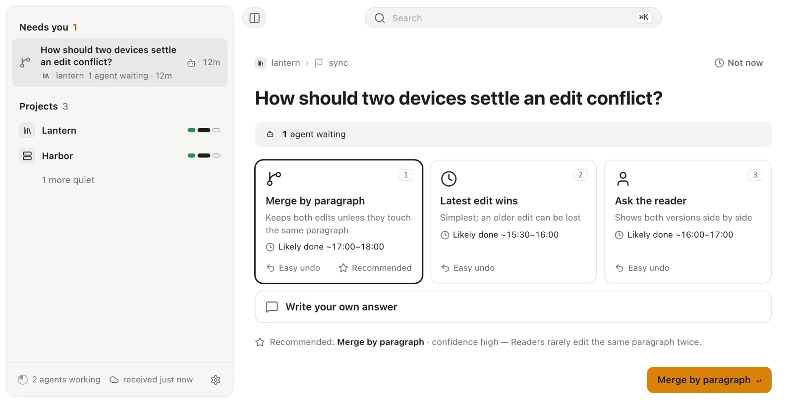
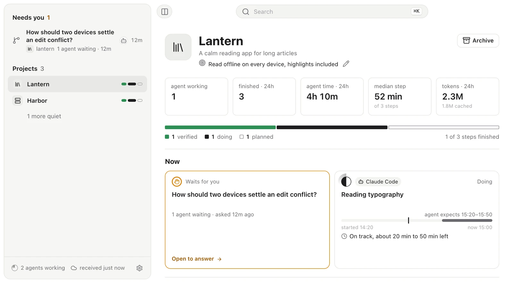
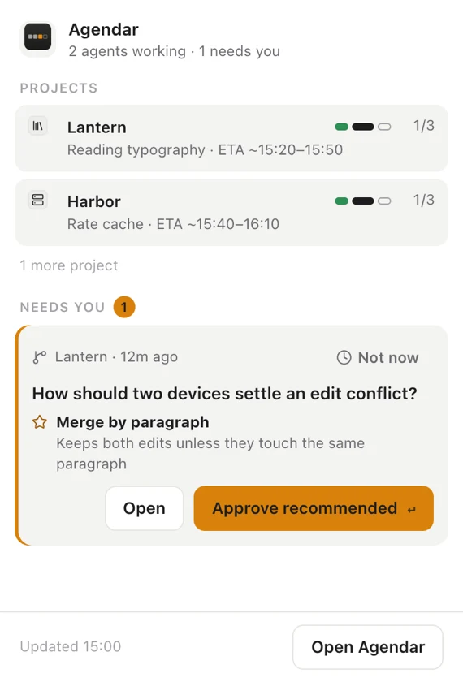

<p align="center">
  
</p>

<h1 align="center">Agendar</h1>

<p align="center">
  <b>像 product manager 一样管理你的 agent 团队。</b><br>
  面向 AI 编程 agent 的工作议程。只列出需要你处理的事。你一回答，提问的那个 agent 会话就接着往下做。
</p>

<p align="center">
  支持 Claude Code、Codex、Cursor、Gemini CLI、Antigravity、opencode、pi，以及任何能跑 shell 的 agent。
</p>

<p align="center">
  <a href="https://github.com/Maolon/agendar/actions/workflows/check.yml"></a>
  <a href="https://github.com/Maolon/agendar/releases/latest"></a>
  <a href="LICENSE"></a>
  
</p>

<p align="center">
  <a href="README.md">English</a> | 简体中文
</p>

<p align="center">
  <picture>
    <source media="(prefers-color-scheme: dark)" srcset="docs/images/decision-dark.webp">
    
  </picture>
</p>

## 为什么做这个

Product manager 不会盯着团队敲键盘。他们定计划，拍板只有自己能定的问题，看 demo，然后决定接受还是退回。

带一群编程 agent 时，你承担的就是这个角色，手头却没有趁手的工具。一个 agent 在你没盯着的终端标签页里卡在某个问题上，后面的步骤全跟着停摆。另一个自称“做完了”，却没人核验。还有一个早在一小时前就没了动静。想摸清状况，只能去翻一整墙的终端。

Agendar 就是这张办公桌。agent 在哪里跑由你决定。它们把计划和进度报到 Agendar，有问题在这里问，做完的活在这里交。你只需要看一张清单：需要你处理的事。

- **计划。** agent 自己声明项目、步骤和依赖关系。你会看到按步骤排列的进度方块、计划依赖图，以及根据过往实际耗时校准的完工时间预测。
- **决策。** 问题做成卡片送到你手边：两到四个选项、每个选项的代价、agent 的推荐，以及你的回答能解开哪些后续步骤。卡片按延误代价排序。
- **回答即唤醒。** 在应用、菜单栏或通知里直接作答。提问的会话会收到附有“完成标准”的回执，接着往下执行。
- **验收。** 做完的活以交付的形式送来，附带 demo（截图、命令行记录、几段关键 diff），并交代清楚哪些已证实、哪些尚未证实、哪些暂时模拟。你可以直接接受，也可以在 demo 上批注后退回。
- **状态自动修正。** 如果某个会话中断，或者超过 24 小时没有消息，它占着的步骤会自动释放，供其他 agent 接手。哪些在推进、哪些停滞、哪些还没人碰，看板上一目了然。不用你去催进度。
- **预算和策略。** 开工满四小时还没有 demo，会标成“无演示”。策略（严格、均衡、自动驾驶）决定哪些问题必须问你，哪些允许 agent 先按假设推进。
- **报告。** 拍板前要看的提案，或是测试、审计得出的发现。在应用里看摘要，在浏览器里打开全文。
- **本地优先。** 数据就是你指定文件夹里的普通文件。没有服务器，没有账号，没有遥测。

Agendar 不启动 agent，也不给它们派活。计划由 agent 自己声明、自己汇报。你负责拍板、验收、暂停和砍掉步骤。

## 工作方式

1. **agent 查看看板并汇报进度。** 认领一个步骤，报上预计完成时间。

   ```sh
   agendar board
   agendar progress started --node core/wake --eta 30m..1h30m
   ```

2. **agent 提问。** `ask` 立即返回，并告诉 agent 要不要等。agent 先把不依赖这个答案的步骤做完，再等你的回答。

   ```sh
   agendar ask --question "Delete the build cache?" \
     --option "Delete: frees 49 GB" --option "Keep: next build is fast" --recommend 1
   agendar wait <ask-id>
   ```

3. **你回答。** 卡片出现在“待你处理”下面。选一个选项，或者自己写答案。agent 那边的 `wait` 收到回执后照着执行，再运行 `agendar ack <answer-id>` 确认。

4. **agent 交付，你验收。** 点“接受”，步骤关闭。点“退回”，步骤重新打开，你的批注会直接发回给同一个会话。

   ```sh
   agendar deliver --node core/wake --attempt <attempt-id> --json delivery.json
   agendar wait --delivery <delivery-id>
   agendar settle
   ```

这些命令由 agent 从 [Agent Skill](skills/agendar/SKILL.md) 里学会，不需要你手敲。

## 你会看到什么

<table>
  <tr>
    <td width="68%">
      <picture>
        <source media="(prefers-color-scheme: dark)" srcset="docs/images/project-dark.webp">
        
      </picture>
    </td>
    <td width="32%">
      <picture>
        <source media="(prefers-color-scheme: dark)" srcset="docs/images/tray-dark.webp">
        
      </picture>
    </td>
  </tr>
</table>

- **待你处理。** 待回答的问题、待审阅的交付、待确认的假设答案，以及争用中的步骤。点“稍后”可以把条目推迟一小时、一天或一周，并在共用同一个 Vault 的电脑间同步。
- **项目页。** 各步骤进度、每个 agent 当前在做的事与预计完成时间、报告、动态和计划图。
- **菜单栏。** 置顶最紧迫的问题，带“批准推荐项”按钮。难以撤销的选择会让你回到主窗口确认。
- **搜索。** 跨项目、步骤、决策、报告和交付搜索。
- **界面语言：** English、简体中文、繁體中文，支持浅色和深色模式。

## 支持的 agent

| Agent | 接入方式 |
|---|---|
| Claude Code | Hooks。后台 hook 会用你的回答或验收结果唤醒空闲会话 |
| Codex | Hooks。线程在下一轮拿到你的回答 |
| Cursor、Gemini CLI、Antigravity、opencode、pi | MCP 服务器（`agendar mcp`），提供 `ask` 和 `wait` 等工具 |
| 任何能跑 shell 的 agent | `agendar` 命令行和 Agent Skill |

Paseo、Conductor 这类 agent 环境，以及 Claude 和 Codex 桌面应用，是运行 agent 的车间。Agendar 放在它们旁边配合使用，哪一个都能搭。

## 安装

**1. 下载应用。** 到[最新版本](https://github.com/Maolon/agendar/releases/latest)页面下载。命令行工具已经内置在应用里，不用另外安装。

| 平台 | 文件 |
|---|---|
| macOS，Apple 芯片 | `Agendar_<version>_aarch64.dmg` |
| macOS，Intel | `Agendar_<version>_x64.dmg` |
| Windows | `Agendar_<version>_x64-setup.exe` |
| Linux | `.deb` 或 `.AppImage` |

首次启动时，设置向导会让你选择存放议程的文件夹，并询问是否把 `agendar` 链接到 PATH。在你点击按钮前，它不会安装任何东西。

> **macOS：** 应用尚未公证。首次打开后，请到**系统设置 > 隐私与安全性**里点击**仍要打开**。或者在终端运行一次
> `xattr -dr com.apple.quarantine /Applications/Agendar.app`。
> **Windows：** SmartScreen 可能提示发布者未知，选择**更多信息 > 仍要运行**。

**2. 接入你的 agent。** 在 **设置 > Agent** 里操作，或者在 agent 所在的终端里运行：

```sh
agendar bind        # 自动识别 harness，添加 hooks 或 MCP 服务器
agendar bindings    # 查看这台机器上每个 harness 的接入情况
```

**3. 让 agent 掌握这套流程。** 安装 Agent Skill：

```sh
npx skills add Maolon/agendar -g
```

每个版本还单独提供独立的 `agendar` 命令行包（`agendar-cli-*`），方便装在只跑 agent 的机器上。每个文件都附有 `.sha256` 校验和。

## 原则

- **本地。** 记录是保存在同一个文件夹（Vault）里的 JSON Lines 纯文本文件。你可以把它放进 iCloud Drive、OneDrive、Dropbox、Syncthing 同步，也可以只留在本地磁盘。
- **没有服务器，没有账号。** 每台机器只往自己的文件里追加记录。共用同一个文件夹的多台机器靠重放事件达成一致。
- **没有遥测。** 唯一的网络请求是向 GitHub releases API 检查更新。它不会安装任何东西，也随时可以关掉。
- **先征得同意。** 设置向导在你点按钮之前什么都不装。`agendar install-hooks` 和 `agendar install-mcp` 默认只打印计划，加 `--yes` 才会写入。
- **状态如实。** agent 自称的“完成”显示为“Agent 称”。只有应用实际观察到的结果才显示为“已查看”。
- **开源。** MIT 许可证。

## 常见问题

**它和 Paseo、Conductor，或者 Claude、Codex 桌面应用这类 agent 环境有什么不同？**
那些工具负责运行 agent：给每个 agent 分配 worktree、终端和对话窗口。它们是车间。Agendar 不运行 agent。它是摆在任意环境旁边的看板和决策回路，能同时覆盖你正在用的所有环境。如果你只用一个环境、一次只跑一个 agent，它自带的对话窗口可能就够用了。

**Agendar 会启动 agent 或者派活吗？**
不会。计划由 agent 自己声明，步骤由 agent 自己认领。你负责回答问题、审阅交付、修改项目目标，或者暂停、砍掉步骤。Agendar 只记录这些决定，从不启动、恢复或停止任何会话。

**我的回答怎么送到 agent 手里？**
在 Claude Code 里，后台 hook 会等待你的回答，拿到后直接唤醒空闲会话。Codex 通过 hooks 在线程的下一轮拿到回答。走 MCP 的 agent 调用 `wait` 工具。其他 agent 运行 `agendar wait <ask-id>` 或读取 `agendar inbox`。

**我一直不回答会怎样？**
卡片可以带默认项。倒计时结束后，agent 会先按推荐项继续推进，这个回答则会作为一条待确认的假设显示给你。如果没有默认项，当前步骤会暂停等待，其他步骤照常进行。

**我的数据在哪里？**
全在你设置时选定的文件夹里，保存为普通文件，另外在应用的本地数据目录里有一份索引。数据不会发往任何地方。应用会读取本机 Claude Code 和 Codex 日志里的 token 计数来显示用量，不保留消息内容。

**几台机器可以共用一份议程吗？**
可以，把它们指向同一个同步文件夹就行。这套机制已经用模拟主机测试过，不过真实的多机使用目前还不多。

**支持哪些平台？**
macOS（Apple 芯片和 Intel）、Windows 和 Linux。日常测试都在 macOS 上进行。Windows 和 Linux 能正常构建并通过 CI 测试，但实际使用还很少。

**要钱吗？**
不要。Agendar 免费且开源。

## 从源码构建

需要 Rust 1.94.1（在 `rust-toolchain.toml` 里固定）、Node 26 和 `pnpm@10.33.2`。

```sh
pnpm -C app install --frozen-lockfile
cargo test --workspace
pnpm -C app test

# 用示例数据运行应用，不需要设置
cd app && VITE_AGENDAR_FIXTURES=1 pnpm dev

# 构建可安装的应用（命令行工具打包在里面）
cd app && node scripts/bundle-cli.mjs && pnpm exec tauri build --bundles app
```

目录结构：

- `crates/agendar-core`：事件模型、只追加的存储、SQLite 索引，以及把事件收敛为计划、进度、决策和预测的 reducer。
- `crates/agendar-cli`：agent 运行的 `agendar` 命令，包括 MCP 服务器和各 harness 的 hooks。
- `crates/agendar-notify`、`crates/agendar-chrome`、`crates/agendar-ffi`：桌面原生通知、macOS 窗口外观，以及面向 core 的 UniFFI 接口层。
- `app/`：桌面应用（Tauri 2、React 和 TypeScript）。
- `skills/agendar/`：Agent Skill。

改动和发版流程见 [`CONTRIBUTING.md`](CONTRIBUTING.md)，修改代码的规则（对人和对编程 agent 均适用）见 [`AGENTS.md`](AGENTS.md)。

## 许可证

[MIT](LICENSE)
